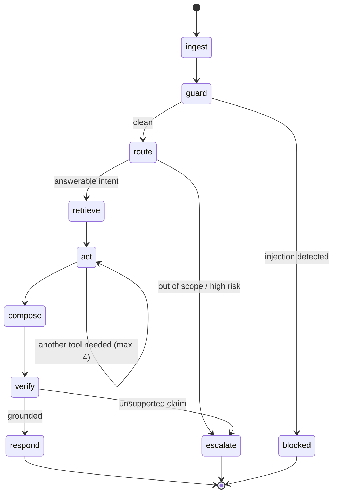

# Agent Runtime

> **Status:** Draft for review · **Last updated:** 2026-07-25

How an agent is actually executed: the graph, the tools, the policy engine that authorises them, memory, escalation, and shadow mode. Built for NEURA-CARE, designed so agents 2–5 reuse all of it.

---

## 1. Why an Explicit Graph

The obvious design is a loop: give the model tools, let it decide, repeat until done. We are not doing that, for four reasons that all bite in production:

- **Debuggability.** "Why did it say that?" must be answerable. A named node with recorded state answers it; an opaque loop does not.
- **Local models.** 8–9B models drift and loop when handed open-ended agency ([llm-abstraction.md §9](llm-abstraction.md)). Constraining the flow is what makes the local tier viable at all.
- **Enforcement points.** Guard and verify must be structural steps, not instructions the model can talk its way past.
- **Cost.** Each node picks the cheapest adequate model role. A loop uses the biggest model for everything.

LangGraph with a **PostgreSQL checkpointer** gives durable, resumable, inspectable state. Recorded in [ADR-0004](adr/0004-langgraph-explicit-graph.md).

---

## 2. The CARE Graph



| Node | Does | LLM role | Failure → |
|:--|:--|:--|:--|
| `ingest` | Load conversation, tenant config, negotiate capabilities → tool set | — | 500 |
| `guard` | Prompt-injection scan, PII redaction | **none — deterministic** | `blocked` |
| `route` | Classify intent, extract entities (order ref, product, topic) | `ROUTER` | `escalate` |
| `retrieve` | pgvector search, tenant + model scoped | `EMBEDDER` | continue with no context |
| `act` | Select and execute tools through the policy engine | `REASONER` | `escalate` |
| `compose` | Draft the answer from retrieved context + tool results | `REASONER` | `escalate` |
| `verify` | Groundedness check: is every claim supported? **Plus a deterministic outbound PII check** | `GUARD` | `escalate` |
| `respond` | Rehydrate PII, stream, persist, meter | — | — |
| `escalate` | Create a human handoff with full context | `SUMMARIZER` | — |
| `blocked` | Safe refusal, security event logged | — | — |

**`guard` has no model, and that is a decision rather than an omission** ([ADR-0011](adr/0011-deterministic-guard-not-classifier.md), milestone 1.12). It is five named rules over the shopper's text plus reversible PII tokenisation. A classifier would need a threshold, there is no labelled corpus to tune one against, and a classifier reading the attacker's text is itself injectable. The `GUARD` role survives on `verify`, where the job is grading a draft against evidence rather than judging an adversary.

**`guard` is the entry node, and the builder enforces it.** A guard reached after `route` has already shown the raw message to a model, so its redaction is redaction of something already disclosed. `blocked` must be terminal for the mirror-image reason.

**`act` is capped at 4 tool calls.** Local models loop. The cap turns an infinite loop into an escalation, which is a good outcome rather than a hung request and a burned budget.

**`verify` is the single most valuable node.** It enforces [operating principle 2 — *grounded or silent*](../business/blueprint-v2.md#7-operating-principles). It re-reads the draft against the retrieved evidence and tool outputs and asks whether each factual claim is supported. Unsupported → escalate. A confident wrong answer about someone's order or money is the worst thing this product can do; escalation is always the cheaper error.

---

## 3. The Tool Layer

Tools are how the agent touches the world. Everything about their safety is enforced here, in code — never by prompt.

### 3.1 Declaration

```python
@tool(
    name="get_order_status",
    description="Look up the current status and tracking info for one order.",
    requires=[Capability.ORDER_READ],
    side_effect=SideEffect.READ,
    scopes=["care:order:read"],
    pii_output=True,  # result contains customer data → never semantically cached
    timeout_s=5.0,
)
async def get_order_status(
    order_ref: str,
    ctx: ToolContext,
) -> OrderStatusResult: ...
```

Four declarations do the real work:

- **`requires`** — commerce capabilities. Tools whose requirements the tenant's adapter cannot satisfy are never registered for that conversation. See [commerce-integration.md §3.2](commerce-integration.md).
- **`side_effect`** — `READ` / `WRITE` / `IRREVERSIBLE`. Drives the approval gate.
- **`scopes`** — checked against the API key and tenant policy.
- **`pii_output`** — propagates a non-cacheable flag, so customer data can never leak through the semantic response cache.

### 3.2 Side-effect classes

| Class | Examples | MVP | Gate |
|:--|:--|:--|:--|
| `READ` | order status, product search, policy lookup | ✅ enabled | Capability + scope |
| `WRITE` | update address, add order note | Phase 2 | Capability + scope + **human approval** |
| `IRREVERSIBLE` | cancel order, issue refund, block transaction | Phase 3 | Capability + scope + **explicit merchant approval per action** |

**MVP registers `READ` tools only.** The agent physically cannot mutate a store. That is not a limitation to apologise for — it is what makes shadow mode and an early pilot safe.

### 3.3 The policy engine

Every tool call passes through it. It is the security boundary, and it runs *outside* the model.

```
LLM proposes: get_order_status(order_ref="1001")
        │
        ▼
  1. Is the tool registered for this conversation?      ── no ──► reject
  2. Does the adapter declare the required capability?  ── no ──► reject
  3. Does the API key hold the scope?                   ── no ──► reject
  4. Does tenant policy allow it in this mode?          ── no ──► reject
  5. Side effect > READ?                                ── yes ─► approval queue
  6. Arguments valid against the JSON schema?           ── no ──► repair loop
  7. Ownership check: may this session see this order?  ── no ──► escalate
  8. Rate limit / budget for this conversation?         ── no ──► degrade
        │
        ▼
  execute · record in the immutable audit log
```

**Step 7 deserves emphasis.** An anonymous shopper asking about "order 1001" must not receive a stranger's order. Verification (order number + matching email, magic link, or authenticated session) is enforced here, in code — never by asking the model to be careful. Detail in [security-model.md](security-model.md).

Every decision — allow and reject alike — is written to the audit log. Rejections are the record that proves the [injection suite](evaluation-strategy.md) actually passes.

### 3.4 MVP tool set

| Tool | Requires | Intent served |
|:--|:--|:--|
| `get_order_status` | `ORDER_READ` | Order status |
| `find_orders_for_customer` | `ORDER_SEARCH`, `CUSTOMER_READ` | Order status |
| `search_products` | `PRODUCT_SEARCH` | Product Q&A |
| `get_product_details` | `PRODUCT_READ` | Product Q&A |
| `check_stock` | `INVENTORY_READ` | Product Q&A |
| `search_policies` | `POLICY_READ` | Returns/shipping |
| `escalate_to_human` | — | All |

`escalate_to_human` is always available. It is the only action the agent can *always* take, by design.

---

## 4. Memory

Four tiers, each with a different lifetime and purpose.

| Tier | Store | Lifetime | Contents |
|:--|:--|:--|:--|
| **Working** | LangGraph checkpoint (Postgres) | One run, resumable | Node state, tool results, intermediate reasoning |
| **Session** | Redis | Conversation + 24h | Recent turns, redaction token map, rate counters |
| **Conversation** | Postgres | Retention policy | Full transcript, resolution, escalation, grades |
| **Semantic** | pgvector | Until re-sync | Catalogue, policies, FAQs — `(tenant_id, embedding_model)` scoped |

**Cross-agent shared memory is deliberately not built.** It is the [ecosystem moat](../business/blueprint-v2.md#22-the-ecosystem-moat-is-real-but-it-is-a-later-moat), but with one agent it has nothing to share. `neura-domain` defines the event schemas now so the seam exists; the bus arrives with agent #2.

### 4.1 Context assembly

Context is assembled deterministically, in priority order, to a role-specific token budget (local models have smaller windows — [llm-abstraction.md §9](llm-abstraction.md)):

```
1. System prompt          tenant persona, capability limits, AI disclosure
2. Tool schemas           only capability-filtered tools
3. Retrieved context      top-k chunks, clearly delimited as UNTRUSTED
4. Tool results           this run
5. Recent turns           newest first, truncated to budget
6. The user message       delimited as UNTRUSTED
```

Retrieved catalogue text and shopper messages are both **untrusted** and are wrapped in explicit delimiters. A merchant's product description is user-generated content too, and is a real injection vector.

---

## 5. Escalation

An escalation is a **successful outcome**, not a failure. The agent escalates when it should, and the metric we optimise is escalation *precision*, not escalation *rate*.

**Triggers:** low routing confidence · out-of-scope intent · `verify` finds an unsupported claim · a required tool is unavailable · tool-call cap reached · budget circuit open · injection detected · the customer asks for a human · sentiment/frustration signals (Phase 2).

**The handoff carries everything a human needs to resolve in one touch:**

```
Conversation  cnv_01J8...        Tenant  Acme Store        Escalated  2026-07-25 14:32 UTC
Reason        verify: unsupported claim about refund window

Summary       Customer asks whether order 1001, delivered 40 days ago, can still be
              returned. Store policy states 30 days; customer says support promised
              an extension. No record of that promise is retrievable.

Customer      jane@example.com · 4 previous orders · no prior escalations
Order         #1001 · delivered 2026-06-15 · $142.50 · 3 items
Retrieved     policy:returns-v3 (30-day window)
Tools used    get_order_status ✔ · search_policies ✔
Draft (not sent)
              "Our policy allows returns within 30 days, so unfortunately…"
Suggested     Confirm whether an extension was granted; consider goodwill exception.
Transcript    [full]
```

The draft is shown but **not sent** — the human decides. That is [operating principle 1](../business/blueprint-v2.md#7-operating-principles) in practice.

---

## 6. Shadow Mode

The agent runs on real traffic, takes no action, and logs what it *would* have done. Humans grade it.

It is both the safest way to deploy and the most persuasive thing we can show a merchant — six weeks of evidence that the agent is right before it is allowed to speak. It is therefore Phase 1, not an afterthought.

```
Real conversation ──► human answers the customer (as today)
        │
        └──► agent runs in parallel
                  · full graph, READ tools only
                  · nothing sent to the customer
                  · records draft, tools, retrieval, cost, latency
                            │
                            ▼
                   Review queue: agree / disagree / would-have-harmed
                            │
                            ▼
              Scorecard  +  golden dataset  +  go-live decision
```

**Modes, as a progression:**

| Mode | Customer sees | Used for | Built |
|:--|:--|:--|:--|
| `SHADOW` | Nothing | Pre-launch validation, model swaps | ✅ 1.15 |
| `SUGGEST` | Nothing — the human sees a draft | Human-in-the-loop assist | ❌ needs a console |
| `SUPERVISED` | Agent replies, human can recall within N seconds | Cautious go-live | ❌ needs a recall path |
| `LIVE` | Agent replies | Steady state | ✅ the default |

Mode is per-tenant **and** per-intent — a store can run `LIVE` for order status while keeping returns policy in `SUGGEST`. This is how a merchant is talked into adopting it: they choose exactly how much rope to give it.

**Two of the four are deliberately absent rather than accepted and ignored** (1.15). From the serving layer's point of view `SUGGEST` *is* `SHADOW` — what separates them is a console for the human to read the draft in, and that is Phase 2. `SUPERVISED` needs a recall path, a timer and a button. A tenant configuring either today would silently get the mode this deployment understands, so an unreadable mode resolves to **`SHADOW`**: the failure shows up as an agent that has gone quiet, never as one that has started talking (`neura_core.tenancy.modes`).

**How 1.15 built it: the mode gates the turn, it does not fork it.** A shadow turn runs the whole graph — same tools, same policy engine, same `verify` — and the reply is withheld at the end. There is deliberately no second execution path, because a shadow run whose behaviour differs from the live one measures a system nobody is going to ship. Three consequences, each of which is a place this could have gone silently wrong:

- **The mode is resolved *after* the turn**, because it is per-intent and the intent is something the turn produces. A `step` frame may therefore reach a WebSocket before the mode is known — safe, because those name a node and nothing about the answer. No `token` frame is ever sent.
- **The draft is not written to the transcript.** A reply nobody read must not become history the next turn answers against, and that error is invisible precisely because the transcript is what "what happened" is later read from. The shopper's own message *is* written; the draft goes to `shadow_turns`.
- **A shadow turn still costs money and still writes a usage row**, and it emits no `conversation.resolved` or `conversation.escalated` webhook. The merchant is paying for the evidence; they are not being told a colleague was called when nobody was.

Graded shadow conversations feed the golden dataset ([evaluation-strategy.md](evaluation-strategy.md)), so the review effort compounds instead of evaporating.

---

## 7. Building Agent #2

The expandability test. A new agent supplies:

1. **A graph** — reusing `guard`, `retrieve`, `verify`, `escalate` from `neura-agent-core`.
2. **Tools** — declared as in §3.1; the registry, policy engine and capability filtering are shared.
3. **Prompts** — versioned, in `prompts/`, never inline.
4. **A golden dataset** — no agent ships without one.

It inherits, at zero cost: policy engine, audit log, memory tiers, escalation, shadow mode, budgets, observability, multi-tenancy.

**Nothing in `neura-agent-core` knows CARE exists** — enforced by the layering check in [overview.md §8](overview.md#8-verification).

---

## 8. Prompts

- **Version-controlled files**, never inline strings. Reviewable, diffable, blameable.
- **Content-hashed**; the hash is recorded on every conversation. Given any past answer we can retrieve the exact prompt that produced it — an EU AI Act traceability requirement and an ordinary debugging necessity.
- **Tenant overrides are constrained.** A merchant may adjust persona and tone. A merchant may **not** override safety instructions, disclosure, or tool authorisation — that is the policy engine's job and it is not addressable from a prompt.
- **Changes require an eval run.** A prompt edit is a behaviour change and is gated exactly like a code change.

---

## 9. Open Questions

1. **Streaming vs. verify.** `verify` runs after `compose`, so a fully streamed answer could be retracted mid-sentence. Options: stream only after verify (slower first token), or stream with a fast pre-check. Needs a decision before the widget ships.
2. **Multi-turn tool state.** If a shopper supplies an order number in turn 1 and asks about it in turn 4, how long does verified ownership persist? Proposed: session lifetime, re-verified on any new order reference.
3. **`act` cap of 4.** A starting number, not a measured one. Tune from eval data.
4. **Shadow-mode review load.** Grading is human time. How much is realistically available in a pilot, and what sampling rate does that imply?
