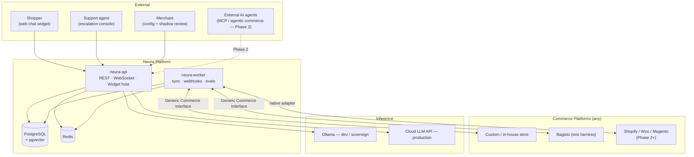

# Architecture Overview

> **Status:** Draft for review · **Last updated:** 2026-07-25

This document is the entry point to the technical design. It explains the shape of the system, why it has that shape, and where everything lives. Detailed decisions live in the sibling documents and in [`adr/`](adr/).

---

## 1. Design Goals

Ranked. When two goals conflict, the higher one wins.

1. **Platform independence.** The system must integrate with *any* commerce platform — Shopify, WooCommerce, Magento, Bagisto, or a store somebody built last month in Laravel. This is the product, not a feature. It is why the ICP in [blueprint-v2 §3](../business/blueprint-v2.md) is reachable at all.
2. **Provider independence.** Development runs on local Ollama models (zero budget); production runs on cloud APIs. Swapping must be a configuration change with a *measured* quality delta, not a rewrite.
3. **Safe by construction.** An LLM that can call tools, fed untrusted text by strangers, is a security surface. Authorisation is enforced in code; the model is never trusted to police itself.
4. **Expandable.** One agent today, five later. New agents, tools, adapters and providers must slot into existing seams rather than force refactors.
5. **Operable by one person.** Every added moving part must earn its keep. A distributed system at zero traffic is all cost and no benefit.

### Explicit non-goals for Phase 1

Microservices · horizontal autoscaling · multi-region · self-serve signup · billing · fine-tuning · training on customer data.

---

## 2. System Context



**Key reading of this diagram:** the platform never speaks any store's native dialect. It speaks *one* contract — the Generic Commerce Interface — and adapters translate. See [commerce-integration.md](commerce-integration.md).

---

## 3. Containers

Phase 1 deploys **two processes** against **two datastores**.

| Container | What it is | Responsibilities |
|:--|:--|:--|
| **neura-api** | FastAPI (ASGI) | REST `/v1/*`, WebSocket chat, widget hosting, auth, tenancy, rate limiting, agent execution |
| **neura-worker** | Async task runner | Catalogue/order sync, outbound webhook delivery + retries, reindexing, scheduled evals |
| **PostgreSQL 16 + pgvector** | Primary store | Tenants, canonical commerce data, conversations, audit log, LangGraph checkpoints, **and vectors** |
| **Redis 7** | Ephemeral store | Session state, rate-limit counters, task queue, cache |

Optional in dev, recommended in prod: **Langfuse** (self-hosted LLM observability) and an **OTLP collector**.

> **Why one process, not the microservices split in `implementation_plan_1`?**
> An `api-gateway` service calling an `agent-care` service over HTTP adds a network hop, a serialization boundary, a second deployment, distributed tracing complexity, and partial-failure handling — in exchange for scaling characteristics we do not need at zero traffic. The package boundaries in §4 mean splitting later is a deployment change, not a redesign. Recorded in [ADR-0002](adr/0002-modular-monolith.md).

---

## 4. Package Map

A `uv` workspace. Boundaries are real and enforced; deployment is single-process.

Three top-level categories, each with exactly one meaning: **libraries**, **products**, **deployables**.

```
neura-agents/
├── pyproject.toml              # uv workspace root
├── docs/
│
├── packages/                   # LIBRARIES — shared machinery, no product identity
│   ├── neura-core/             #   config · logging · OTel · errors · auth · crypto
│   ├── neura-domain/           #   canonical models + event schemas  (PURE — no I/O)
│   ├── neura-llm/              #   provider abstraction · model roles · structured output
│   ├── neura-commerce/         #   adapter Protocol · capabilities · registry · sync engine
│   ├── neura-agent-core/       #   graph engine · shared nodes · tool registry · policy · memory
│   └── neura-adapters/         #   generic/ (Tier 2) · shopify/, woocommerce/ (Phase 2+)
│
├── agents/                     # PRODUCTS — one folder per sellable agent
│   ├── care/                   #   ✅ Phase 1
│   ├── sell/  mind/            #   ⬜ not designed — see docs/agents/README.md
│   └── grow/  guard/           #   ⬜ not designed
│
├── apps/                       # DEPLOYABLES — what actually runs
│   └── neura-api/              #   FastAPI app + worker entrypoint
│
├── evals/                      # eval runner (datasets live inside each agent)
├── infra/                      # docker-compose · Dockerfiles · Alembic migrations
└── tests/                      # integration + e2e
```

Each agent is its own workspace package with a `manifest.py`, `graph.py`, `nodes/`, `tools/`, `prompts/` and `evals/datasets/`, discovered at startup via entry points. Full detail — including how a customer buys one agent rather than five — is in [tenancy-and-packaging.md](tenancy-and-packaging.md).

### 4.1 The dependency rule

Dependencies point **downward only**. This is what makes the system expandable, and it is enforced in CI by an import-linter contract.

```
                 apps/neura-api
                       │
                       ▼
              agents/care  sell  …     ← products; never import each other
                       │
       ┌───────────────┼────────────────┐
       ▼               ▼                ▼
neura-agent-core  neura-commerce   neura-adapters
       │               │                │
       └───────┬───────┴────────────────┘
               ▼
          neura-llm
               │
               ▼
         neura-domain          ← pure: Pydantic only, zero I/O
               │
               ▼
          neura-core           ← config, logging, errors, crypto
```

**Four rules that matter most:**

- `neura-domain` imports nothing but Pydantic and the stdlib. No database, no HTTP, no LLM. It is the vocabulary the whole system shares, and keeping it pure is what allows every other layer to be swapped.
- `neura-adapters` may depend on `neura-commerce`, **never the reverse**. The core must not know that Shopify or Bagisto exist. CI greps for platform names outside the adapters package — see [§8 Verification](#8-verification).
- **`neura-agent-core` never learns an agent's name.** Same rule, same reason: the engine must not know CARE exists.
- **Agents never import each other.** Cross-agent communication goes through the event bus (Phase 3). This is what keeps five products separable rather than fused.

---

## 5. Request Lifecycle

A shopper asks *"where is my order 1001?"*

```
 1  POST /v1/care/chat                    widget → API
 2  Auth · resolve tenant · rate limit    neura-core          (tenant_id now in context)
 3  Load tenant config + adapter          neura-commerce      (capabilities negotiated)
 4  Resolve available tools               neura-agent-core    (filtered by capability + policy)
 5  ── LangGraph run ──────────────────────────────────────────────────────
      guard      injection scan · PII redaction              neura-agent-core
      route      intent classification            [LLM role: router]
      retrieve   pgvector search, tenant-scoped   [LLM role: embedder]
      act        tool calls via policy engine     [LLM role: reasoner]
                    └─ get_order() → adapter → store
      compose    draft answer                     [LLM role: reasoner]
      verify     groundedness check → escalate if unsupported
 6  Persist: conversation, checkpoint, audit log, usage      PostgreSQL
 7  Rehydrate redacted PII · stream response                 → widget
```

Every step emits an OpenTelemetry span carrying `trace_id`, `tenant_id` and `conversation_id`. One trace answers "what did the agent do and why" end to end.

---

## 6. Cross-Cutting Concerns

| Concern | Approach | Detail |
|:--|:--|:--|
| **Multi-tenancy** | `tenant_id` on every row; PostgreSQL Row-Level Security; vector namespaces keyed by `(tenant_id, embedding_model)` | Retrofitting tenancy is effectively a rewrite, so it exists from the first migration |
| **Agent entitlement** | `tenants.enabled_agents` gates routes, scopes, tools, billing and UI | How one customer buys CARE alone from a single deployment — [tenancy-and-packaging.md](tenancy-and-packaging.md) |
| **Configuration** | Pydantic `Settings`, env-driven, fail-fast at boot | `neura-core/config.py` |
| **Errors** | One exception hierarchy → one wire error shape | [api-design.md](api-design.md) |
| **Logging** | Structured JSON with trace/tenant/conversation IDs | `neura-core/logging.py` |
| **Tracing** | OpenTelemetry HTTP → node → tool → LLM; Langfuse for LLM-specific traces | [ADR-0007](adr/0007-langfuse-observability.md) |
| **Migrations** | Alembic, forward-only, reviewed | `infra/migrations` |
| **Secrets** | Envelope encryption for tenant store credentials; never plaintext columns | [security-model.md](security-model.md) |
| **Idempotency** | `Idempotency-Key` on every write endpoint | [api-design.md](api-design.md) |
| **Budgets** | Per-tenant token/cost ceilings with circuit breakers; degrade to escalate-only | [llm-abstraction.md](llm-abstraction.md) |

---

## 7. Technology Choices

| Layer | Choice | Rationale |
|:--|:--|:--|
| Language | **Python 3.12** | AI ecosystem. Pinned to 3.12 deliberately — 3.14 is installed on this machine but many ML/agent libraries still lack wheels for it |
| Packaging | **uv** workspace | Fast, native workspace support, reproducible lockfile |
| API | **FastAPI** | Async, Pydantic-native, generates the OpenAPI spec we publish |
| Agent runtime | **LangGraph** | Explicit state machine with durable checkpointing — debuggable and resumable, unlike an opaque agent loop |
| Database | **PostgreSQL 16 + pgvector** | One datastore for relational *and* vector. Dropping a separate vector service removes an entire operational component |
| Cache/queue | **Redis 7** | Sessions, rate limits, task queue |
| Migrations | **Alembic** | Standard; absent from the earlier plan |
| LLM (dev) | **Ollama** via OpenAI-compatible `/v1` | Zero cost; one code path with cloud providers |
| LLM (prod) | Cloud API, config-selected | See [llm-abstraction.md](llm-abstraction.md) |
| LLM observability | **Langfuse**, self-hosted | Free, self-hostable, works with local models — LangSmith assumes a cloud workflow |
| Tracing | **OpenTelemetry** | Vendor-neutral |
| Lint/format | **Ruff** | Fast, single tool |
| Types | **mypy** strict on `packages/` | The boundaries are only real if they typecheck |
| Tests | **pytest** + testcontainers | Real Postgres/Redis in integration tests |
| CI | **GitHub Actions** | lint → typecheck → test → **eval** → build |

Deviations from `implementation_plan_1` are recorded in [ADR-0001](adr/0001-python-monorepo-uv.md) onward.

---

## 8. Verification

How we prove the architecture is real rather than aspirational. All of these run in CI.

| Property | Test |
|:--|:--|
| **Platform independence** | No commerce-platform name (`bagisto`, `shopify`, `woocommerce`, …) appears outside `packages/neura-adapters/` and `docs/`. A grep in CI. This is the single most important check in the repo. |
| **Layering** | `import-linter` contract enforces the §4.1 dependency graph, including that no agent imports another and that `neura-agent-core` names no agent |
| **Domain purity** | `neura-domain` imports only Pydantic + stdlib |
| **Provider independence** | Eval suite runs against both the Ollama role-map and a cloud role-map; the delta is reported, not assumed |
| **Tenant isolation** | Integration test: tenant A's key cannot read tenant B's orders, documents or conversations |
| **Tool safety** | Prompt-injection suite must fail to invoke any write tool — verified against the policy engine's audit log, not the reply text |
| **Spec conformance** | `neura-conformance` passes against the reference store implementation |

---

## 9. Related Documents

| Document | Covers |
|:--|:--|
| [commerce-integration.md](commerce-integration.md) | Canonical model, adapter contract, capability negotiation, three integration tiers, sync engine |
| [tenancy-and-packaging.md](tenancy-and-packaging.md) | Agent folder structure, manifests, entitlements, and the three delivery modes |
| [llm-abstraction.md](llm-abstraction.md) | Model roles, provider capabilities, structured output, the dev→prod swap |
| [agent-runtime.md](agent-runtime.md) | Graph shape, tool registry, policy engine, memory tiers, shadow mode |
| [security-model.md](security-model.md) | Prompt injection, authorisation, PII, tenancy, secrets, webhooks |
| [evaluation-strategy.md](evaluation-strategy.md) | Golden datasets, metrics, CI gates, model-swap regression |
| [api-design.md](api-design.md) | Versioning, envelopes, errors, idempotency, webhooks |
| [adr/](adr/) | Individual decisions with context and consequences |
